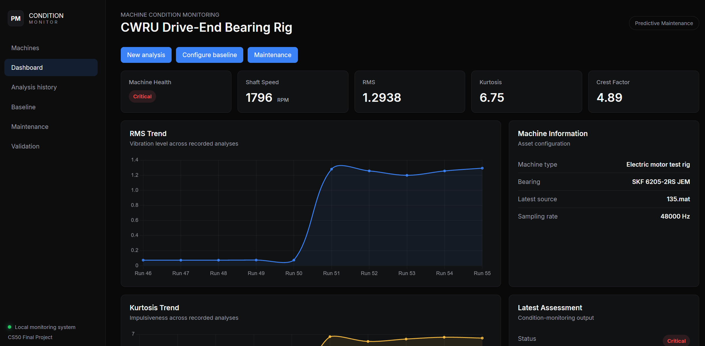
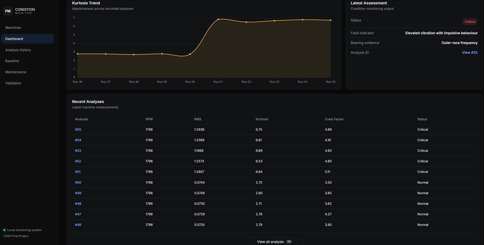
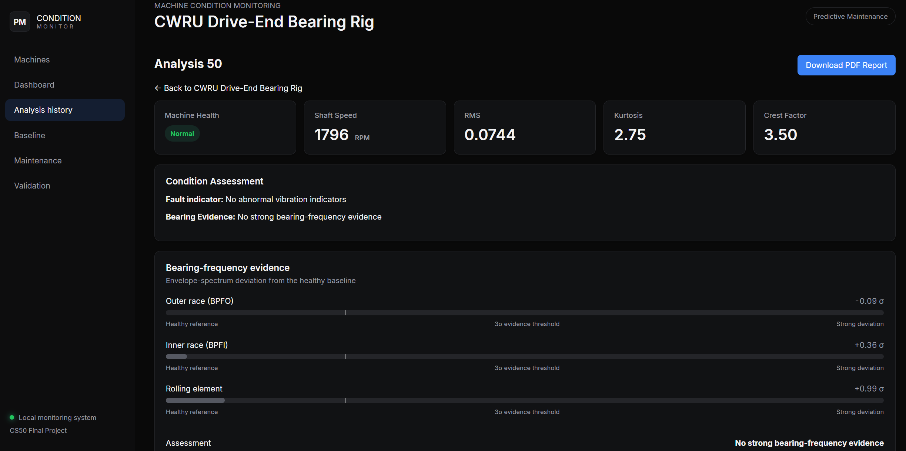
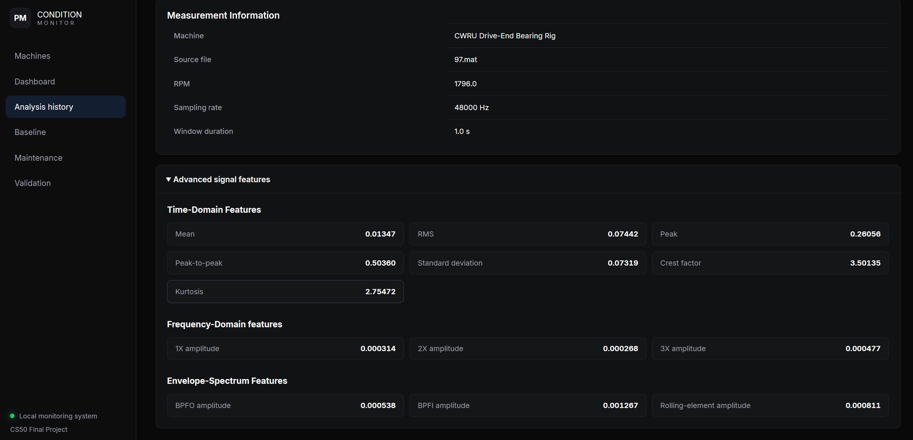
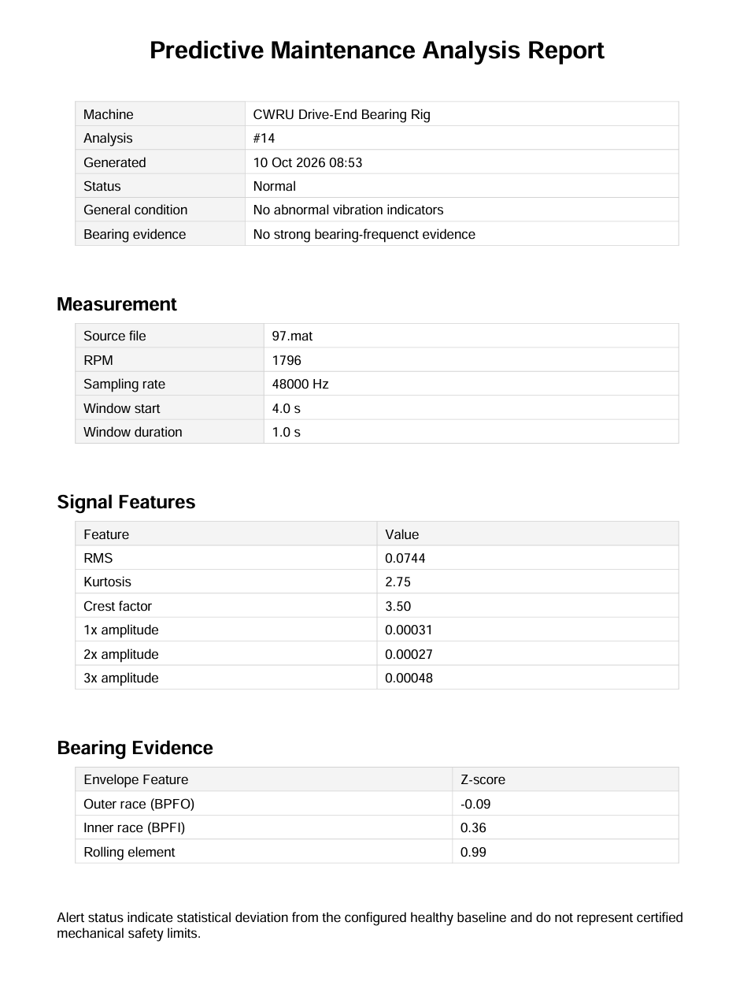
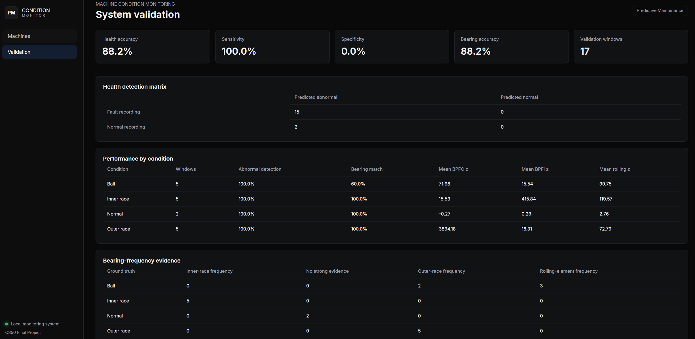

# Predictive Maintenance and Machine Condition Monitoring System

#### Video Demo: <https://youtu.be/FVItbR7tip8>

#### Description:

This project is a vibration-based condition monitoring application that helps engineers detect abnormal machine behaviour and document results for maintenance decisions. This project was built using Python, Flask, and SQLite. It uses the Case Western Reserve University (CWRU) bearing dataset to demonstrate and evaluate the analysis workflow.


> Developed as my final project for Harvard's CS50x: Introduction to Computer Science (2026). This repository represents the initial prototype, with potential for further development and integration with real-world vibration sensors.

## Table of Contents

- [Problem Statement and Objective](#problem-statement-and-objective)
- [Features](#features)
- [How It Works](#how-it-works)
- [Application Preview](#application-preview)
- [Installation](#installation)
- [Usage](#usage)
- [Engineering Background](#engineering-background)
- [Validation](#validation)
- [Tech Stack](#tech-stack)
- [Project Structure](#project-structure)
- [Limitations](#limitation)
- [Future Improvements](#future-improvements)
- [Acknowledgements](#acknowledgements)
- [References](#references)
- [License](#license)

## Problem Statement and Objective

Rotating machinery can develop faults such as imbalance and bearing damage long before complete failure occurs. These faults often produce changes in vibration behaviour. However, raw vibration time series alone is very hard to interpret without signal processing and a healthy reference.

This project combines mechanical vibration analysis with software engineering to create a simple workflow for machine condition assessment and report generation. It turns raw accelerometer readings into condition indicators and compares them to a machine-specific healthy baseline. Then, it reports bearing-fault evidence which an engineer can inspect and verify.

## Features

**Asset and baseline management**
- Machine asset management
- Healthy baseline configuration

**Signal analysis**
- MATLAB (`.mat`) vibration files upload
- Time-domain features extraction: Root Mean Square (RMS), kurtosis, and crest factor
- Fast Fourier Transform (FFT) analysis of 1x, 2x, and 3x running-speed components
- Envelope analysis for bearing defects
- Ball Pass Frequency Outer race (BPFO), Ball Pass Frequency Inner race (BPFI), and rolling-element defect frequencies evidence

**Assessment and records**
- Baseline-relative condition assessment
- SQLite-backed analysis history
- Maintenance records logging
- Validation dashboard
- PDF analysis reports

## How It Works

[](docs/images/pipeline-dark.svg)

The system processed uploaded `.mat` vibration recordings by segmenting the signal and extracting features, such as time-domain features, running-speed frequency components using FFT, and bearing characteristics-frequency components using envelope analysis.

These features are compared against a previously established healthy baseline to assess abnormal vibration behaviour and identify potential bearing-frequency evidence. The results are stored in the database for historical monitoring. Not only so, users can generate a PDF report for engineering documentation.

## Application Preview

### Machine Dashboard





The machine dashboard shows the latest condition assessment, historical RMS and kurtosis trends, recent analysis, baseline status, and maintenance information.

### Analysis Details





This page is the detail page of a single analysis run. It shows every feature the app calculated:

- Bearing evidence with the z-scores for BPFO, BPFI, and the rolling-element
- Measurement information
- Advanced signal features, such as time-domain features (RMS, kurtosis, crest factor, mean, peak, peak-to-peak, and standard deviation), frequency-domain features, and envelope-spectrum features

### Report



The report has the same content as the Analysis Details page and can be exported as a PDF file that can be saved or shared.

## Installation

```bash
git clone https://github.com/crushzz12/predictive-maintenance-system.git
cd predictive-maintenance-system

python -m venv .venv
.venv\Scripts\activate
python -m pip install -e .
```

> **Dataset notice:** The CWRU vibration file are **not included** in this repository (`data/cwru/raw` is git-ignored). To follow the usage steps below, download the files from the [CWRU Bearing Data Center](https://engineering.case.edu/bearingdatacenter/download-data-file) and place them in `data/cwru/raw`. The examples in this README use `97.mat` (healthy baseline) and `109.mat`, `122.mat`, `135.mat` (fault examples).

## Usage

```bash
python src/app.py
```

Open <http://localhost:5000>, then:

### 1. Register a machine

Open **Add Machine** and enter the machine name, type, bearing information, and description.

Each machine has its own analysis history, maintenance records, and healthy baseline.

### 2. Configure a healthy baseline

Open the selected machine and choose **Configure Baseline**.

Upload a vibration recording collected while the machine is known to be operating normally. Enter the required information of the recording.

For a quick demo, use `97.mat` from the CWRU dataset for the healthy baseline.

> **Important:** Use only verified healthy recordings. A baseline containing abnormal vibration can lead to misleading condition assessments.

### 3. Upload a vibration recording

Select **New Analysis** from the machine dashboard and upload a supported MATLAB `.mat` vibration file. Then, enter the required information and start the analysis. The application will automatically perform calculations and save the results to the database (SQLite). 

For fault examples, try `109.mat`, `122.mat`, or `135.mat` from CWRU.

> **Current limitation:** The current version of the application only supports the **CWRU-style MATLAB** file structure. It is not a universal MAT or CSV vibration importer.

### 4. Review analysis details 

Return to the machine dashboard to examine the latest assessment, historical trends, and recent analyses.

Open an individual analysis to inspect its health status, bearing evidence, measurement information, and advanced signal features.

> **Note:** A Normal, Warning, or Critical status indicates a level of statistical deviation from the configured healthy baseline. It is not a certified machinery safety classification.

### 5. Generate an engineering report

From the **Analysis Detail** page (from step 4), select **Download PDF Report**.

This report summarizes the machine, measurement conditions, signal features, condition assessment, and bearing-frequency evidence.

### 6. Review History and Maintenance

Open **Analysis History** to browse previous measurements. Open **Maintenance** to record inspection or maintenance actions associated with the machine.

## Engineering Background

### Predictive Maintenance

Predictive maintenance uses information about equipment condition to identify faults before functional failure occurs. In this project, vibration measurements are used as the condition-monitoring input.

### RMS

Root Mean Square (RMS) represents the overall magnitude of the vibration signal. An increase relative to healthy operation may indicate a change in machine condition, although RMS alone is not sufficient to identify the fault type.

### Kurtosis and Crest Factor

Kurtosis and crest factor are used to identify impulsive behaviour in the vibration waveform. Repeated impacts can occur when damaged bearing surfaces pass through the load zone.

### FFT

The Fast Fourier Transform (FFT) converts the vibration signal from the time-domain to frequency-domain. This allows vibration components near the shaft rotational frequency and its harmonics to be examined.

### Envelope Analysis

Bearing faults often excite high-frequency structural resonance. Envelope analysis demodulates this vibration so that repetitive impact frequencies can be identified more clearly.

### Bearing Characteristic Frequencies

This application evaluates evidence near characteristic bearing frequencies such as:

- BPFO: Ball Pass Frequency Outer race
- BPFI: Ball Pass Frequency Inner race
- Rolling-element defect frequency

These are used as diagnostic evidence rather than treated as absolute proof of a fault.

## Validation



The system correctly identified abnormality in all selected fault windows, but both held out healthy windows generated warning. This is mainly due to RMS deviation from a small healthy baseline. 

Moreover, bearing-frequency localization correctly identified all selected inner-race and outer-race windows, while rolling-element localization was less reliable.

A 0.5 s (window duration) sensitivity experiment improved healthy/fault separation but reduced rolling-element localization. This shows a trade-off between time-domain condition detection and frequency-domain resolution.

## Tech Stack

| Area | Technology |
|:---|:---|
| Programming | Python |
| Web application | Flask, Jinja2 |
| Numerical processing | NumPy |
| Signal processing | SciPy |
| Data handling | Pandas |
| Visualization | Matplotlib, Chart.js |
| Database | SQLite |
| Frontend | HTML, CSS, JavaScript |
| PDF reporting | ReportLab |
| Development | VS Code, Git, GitHub |

## Project Structure

```text
predictive-maintenance-system/
│
├── src/
│   ├── app.py                     # Flask application and routes
│   │
│   ├── predictive_maintenance/
│   │   ├── analysis_service.py    # Analysis workflow
│   │   ├── baseline_service.py    # Healthy baseline workflow
│   │   ├── validation_service.py  # Validation workflow
│   │   ├── report_service.py      # PDF report generation
│   │   ├── data_loader.py         # Vibration file loading/segmentation
│   │   ├── features.py            # Time-domain features
│   │   ├── spectrum.py            # FFT and filtering functions
│   │   ├── bearing.py             # Bearing-frequency calculations
│   │   ├── condition.py           # Condition assessment logic
│   │   └── db.py                  # SQLite database functions
│   │
│   ├── templates/                 # Flask/Jinja HTML pages
│   └── static/                    # CSS, JavaScript, and favicon
│
├── database/
│   └── schema.sql                 # Database schema
│
├── scripts/                       # Validation and diagnostic scripts
├── tutorials/                     # Development/learning experiments
├── results/                       # Validation outputs
├── data/cwru/raw/                 # Local CWRU files, excluded from Git
│
├── pyproject.toml                 # Project dependencies/configuration
├── .gitignore
└── README.md
```

## Limitation

- Validation uses selected CWRU recordings rather than independent machines.

- The healthy baseline contains limited data.

- The system currently supports the CWRU-style MAT structure.

- Alert thresholds are statistical heuristics rather than certified machinery protection limits.

## Future Improvements

- Support CSV and live sensor acquisition
- Use longer healthy baseline recordings
- Use multiple operating loads or speeds
- Automatic envelope-band selection
- BPFO / BPFI harmonic and sideband scoring
- Store raw or compressed spectra for historical comparison
- Multi-resolution analysis windows
- Trend-based degradation detection
- Machine-learning comparison after sufficient labeled data
- Automated maintenance recommendations

## Acknowledgements

- Case Western Reserve University (CWRU) Bearing Data Center - for providing the experimental bearing vibration dataset used in development and validation
- Harvard CS50x - for providing the foundational programming knowledge that supported the development of this project
- OpenAI ChatGPT - used as a learning and development assistant for understanding engineering and programming concepts, discussing software architecture, troubleshooting, reviewing code, and developing implementation examples. The resulting application was implemented, adapted, and tested during the project.

## References

#### Dataset

Case Western Reserve University Bearing Data Center (n.d.) Bearing Data Center. Case School of Engineering. Available at: https://engineering.case.edu/bearingdatacenter/download-data-file (Accessed: 10 October 2026).

#### Bearing diagnostics and validation

Smith, W.A. and Randall, R.B. (2015) 'Rolling element bearing diagnostics using the Case Western Reserve University data: A benchmark study', Mechanical Systems and Signal Processing, 64–65, pp. 100–131. https://doi.org/10.1016/j.ymssp.2015.04.021

Randall, R.B. and Antoni, J. (2011) 'Rolling element bearing diagnostics—A tutorial', Mechanical Systems and Signal Processing, 25(2), pp. 485–520. https://doi.org/10.1016/j.ymssp.2010.07.017

#### Badge styles

Markdown badges for README
https://github.com/inttter/md-badges#%EF%B8%8F-framework

## License

This project is licensed under the MIT License. See [LICENSE](LICENSE) for details.

The license applies to the project's original source code and documentation. Third-party libraries and external datasets remain subject to their respective licenses and usage terms.

The software is provided for educational and experimental condition monitoring and is not certified for safety-critical machinery protection.